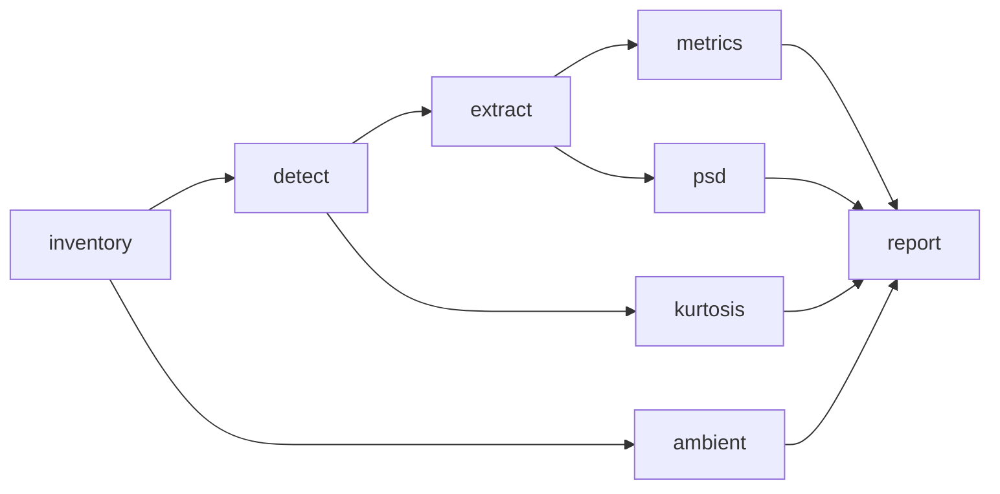

# RODEO II - Pile-Driving Soundscape Analysis

William Jenkins, Ph.D.  
Scripps Institution of Oceanography
University of California San Diego

Soundscape metrics for impulsive pile-driving noise recorded at offshore wind farm construction sites.
The analysis was developed for South Fork Wind (2023) and is generalized so the same workflow runs on any site, currently South Fork Wind and Vineyard Wind.

## Installation

```bash
uv sync --group dev
```

[TritonOA](https://github.com/TritonOA/TritonOA) is used to read raw recordings and is installed from GitHub over SSH.

## Workflow



| Stage       | What it does                                                                 |
| ----------- | ---------------------------------------------------------------------------- |
| `inventory` | Index the raw files of each sensor (or adopt an inventory built elsewhere).  |
| `detect`    | Detect pile strikes automatically on each sensor's detection channel.        |
| `extract`   | Window every channel around each strike, calibrated to uPa.                  |
| `metrics`   | Per-pulse metrics for each channel; writes a site-wide summary table.        |
| `psd`       | Power spectral density and decidecade band exposure of each pulse.          |
| `ambient`   | SPL, kurtosis, and PSD of ambient noise in a window preceding each event.    |
| `kurtosis`  | Kurtosis of the recording in 60 s windows over each event (Martin et al. 2020). |
| `report`    | Figures, LaTeX tables, and a Word document (see [Figures and tables](#figures-and-tables)). |
| `supplement` | PDF data supplement tabulating every pulse (see [Data supplement](#data-supplement)). |

Run from the repository root:

```bash
soundscape run --site config/sites/southfork.toml --data-dir /path/to/raw/data   # everything
soundscape detect --site config/sites/vineyard.toml                                 # one stage
soundscape extract --site config/sites/southfork.toml --event A08 --sensor VLA1
```

`--event` and `--sensor` are repeatable. Naming an event explicitly runs it even if the site configuration excludes it.

## Site configuration

Each site is one TOML file in `config/sites/`, with its tables alongside:

```
config/sites/
├── southfork.toml
├── southfork/
│   ├── events.csv    # event, pile, start, end  (UTC)
│   └── piles.csv     # pile, latitude, longitude
├── vineyard.toml
└── vineyard/
    ├── events.csv
    ├── piles.csv
    └── calibration/3dvha_cal.csv
```

The TOML sets the output directory, the processing parameters, the sensors, and any excluded events or event–sensor pairs.
Each sensor has a description, a position and water depth, its channels, the channel used for detection, a data source, a calibration, and a description of each hydrophone:

```toml
[[sensors]]
name = "VLA1"
description = "SHRU 905 recorder on vertical line array 1"
latitude = 41.08506
longitude = -71.07804
water_depth_m = 34.5
channels = [0, 1, 2, 3]
detect_channel = 0
# [sensors.source] and [sensors.calibration] ...

[[sensors.hydrophones]]
channel = 0
depth_m = 16.2
serial_number = "722013"
description = "CH-0 hydrophone"
```

Hydrophone entries are descriptive (calibration stays in `[sensors.calibration]`), and channels that are not analyzed may be listed to document the instrument.
The serial number identifies a hydrophone across deployments; sensor names such as `VLA1` are labels for one site only, and a serial number may appear only once per site.
`depth_m` is the hydrophone's depth below the sea surface, which moorings are adjusted to keep consistent between deployments; `water_depth_m` is the water depth at the sensor, which changes with the site.
Hydrophone depth and serial number are carried into `metrics.csv`, `ambient_spl.csv`, the pulse files, and the event tables, so results can be compared by depth.

### Data sources

The site files do not say where the raw data are stored.
Data source directories are relative to a data directory passed at run time with `--data-dir`, which the `inventory` stage (and `run`) needs:

```bash
soundscape inventory --site config/sites/southfork.toml --data-dir /path/to/southfork/raw/data
```

All later stages read data through the TritonOA inventory this builds, which records each file's full path, so they need no `--data-dir`.
Rerun `inventory` after moving the data or switching machines.
A source directory given as an absolute path is used as is.
A file whose headers cannot be read (e.g. a corrupt recording) is left out of the inventory with a warning naming it, and the stage carries on; the run's log lists every file left out.

- `type = "glob"` builds the inventory by reading the headers of files in `directory` that match `pattern` (on local disk or a mounted share), with an optional clock-drift correction.
- `type = "inventory"` adopts an inventory built elsewhere. `path_map` rewrites file path prefixes so the same inventory works on another machine.

This replaces the earlier `paths.toml`/`.env` machine-alias scheme.

New kinds of source (e.g. fetching over SSH) can be added in `src/soundscape/sources.py` by implementing `DataSource.prepare()`.

### Calibration

Inventories are kept unconditioned; calibration is applied by this package from the site file:

- `flat`: frequency-independent sensitivity and fixed gain per channel, converting 24-bit counts to uPa (SHRU).
- `frequency_response`: deconvolves a tabulated sensitivity curve from a voltage time series (e.g. a WHOI 3D VHA).
- `none`: data are already in uPa.

Sensitivities are in dB re 1 V/uPa and must be negative.

## Strike detection

Strikes are detected by band-limited energy, generalizing the Vineyard Wind approach:

1. **Scan.** The detection channel is band-passed (`band`, default 100–300 Hz), squared, and smoothed over `smooth_s`. Local maxima at least `min_interval_s` apart are saved as candidates, with the noise floor (median energy) of each chunk. This is the only step that reads data.
2. **Select.** A candidate is a strike when its energy is at least `threshold` times the largest candidate energy within `normalization_window_s`, and at least `min_snr_db` above the noise floor. Setting `normalization_window_s = 0` normalizes by the event maximum (the Vineyard Wind behavior), which misses soft-start strikes in long events.
3. **Regularity.** Pile strikes come in trains about 1–2 s apart, so a strike also needs at least `min_neighbors` other strikes within ±`neighbor_window_s` (default 2 within ±4 s). This rejects isolated transients such as mooring noise, which is broadband and cannot be removed by the choice of band. It can also reject a genuinely isolated strike, e.g. a single blow between piling sequences. Set `min_neighbors = 0` to disable.

All channels of a sensor are windowed at the same strike times, so detections are synchronized across channels.

On Vineyard Wind (pile AN36, 1 December 2023), these settings find all 2,928 strikes of the original hand-tuned analysis on each of the three sensors tested (3DVHA, VLA1, VLA2), within 0.5 s, plus the soft-start strikes that preceded its first time range, without hand-picked time ranges. Raising the band to 300–500 Hz lost 16–23% of the strikes at these 13 km ranges.

To tune the detector, inspect `results/<site>/events/<event>/detections_<sensor>.png`, edit `[detector]` (or a sensor's `[sensors.detector]` override), and re-apply the thresholds to the saved candidates without re-reading data:

```bash
soundscape detect --site config/sites/southfork.toml --reselect
```

## Outputs

```
results/<site>/
├── inventory/<sensor>.csv
├── events/<event>/
│   ├── candidates_<sensor>.parquet
│   ├── detections_<sensor>.csv     # strike times, energy, SNR
│   ├── detections_<sensor>.png     # detector diagnostic
│   ├── pulses_<sensor>.h5          # (strike, channel, sample) waveforms in uPa
│   ├── metrics_<sensor>.csv
│   └── psd_<sensor>.h5
├── metrics.csv                     # all events, sensors, channels
├── ambient.h5                      # ambient PSD per event/sensor
├── ambient_spl.csv                 # ambient SPL and kurtosis per interval
├── kurtosis.csv                    # kurtosis per 60 s window of each event
├── logs/<command>_<time>.log       # one log per run, as printed to the terminal
└── report/                         # figures and LaTeX tables
```

## Figures and tables

`soundscape report` writes, for each event:

- `figures/<event>/metrics.png`: metric time series, one column per sensor (nearest first), colored by hydrophone, with kurtosis in 60 s windows in the bottom row.
- `figures/<event>/psd.png`: pulse PSD and ambient PSD (over 1 min intervals before the event), each as the median and 5th to 95th percentiles in dB, per sensor and hydrophone.
- `figures/<event>/bands.png`: decidecade band levels per sensor and hydrophone: SEL_ss in each band, against the exposure the ambient noise gives over a window of the same length, each as the median and 5th to 95th percentiles. The gap between them is the signal-to-noise ratio in each band.
- `figures/<event>/levels.png`: distribution of `histogram_metric` per hydrophone and sensor.
- `tables/<event>.tex`: per-pulse metrics, one row per hydrophone (sensor, range, serial number, depth), each as the median with the 5th and 95th percentiles in brackets. Times are in ms.
- `tables/<event>_event.tex`: event-level quantities per hydrophone: serial number, valid pulses, SEL_cum over them, kurtosis over the 60 s windows that contain strikes, and ambient kurtosis (median [5th, 95th percentile]), with the mean wind speed and significant wave height if configured.
- `tables/<event>_bands.csv`: the band statistics behind `bands.png`, per sensor, hydrophone, and band, with the ambient mean-square SPL in each band.

and for the whole site:

- `figures/coverage.png`: when each sensor was recording, with every event in the site file on the same time axis, its window, and the sensors that recorded it. It is drawn from the inventories, so it needs no metrics.
- `figures/<metric>_vs_range.png`: each of `range_metrics` against range on each sensor's detection channel, colored by strike number, with the median and interquartile range per event and sensor.
- `tables/detections.tex`: strikes and median SNR per event and sensor.

It also writes `report.docx`, which collects the figures and tables with captions written from the data, for pasting into a shared Word report.
Tables are native Word tables, with each event's tables on a landscape page, and captions are numbered with Word fields, so they renumber in the document they are pasted into (select all and press F9).

### Data supplement

```bash
soundscape supplement --site config/sites/southfork.toml
```

writes `report/supplement.pdf`, a stand-alone PDF tabulating every valid pulse on every hydrophone. It's separate from `report.docx`.
The PDF contains:

- a title page (with `[report] author` and `affiliation`) and a contents table linking to each event;
- a page defining the columns;
- one table per event, in chronological order. Rows are ordered by sensor (nearest first), hydrophone (shallowest first), and strike, and each row gives the hydrophone's serial number and depth.

Column headers repeat on every page, the page header names the event, and PDF bookmarks lead to each event and sensor.

The LaTeX source is written to `report/supplement/supplement.tex` and compiled there with `latexmk` (or `pdflatex` twice). Without LaTeX, only the `.tex` is written.
It needs the `geometry`, `lmodern`, `longtable`, `booktabs`, `makecell`, `array`, `fancyhdr`, `lastpage`, and `hyperref` packages. On Debian/Ubuntu these are in `texlive-latex-recommended`, `texlive-latex-extra`, `texlive-fonts-recommended`, and `lmodern`, plus `latexmk`.
A site of about 400,000 pulse records gives a PDF of several thousand pages and takes a while to compile; `run` includes this stage.

### Comparing sites

```bash
soundscape compare --site config/sites/southfork.toml --site config/sites/vineyard.toml --output results/compare
```

reads each site's results (valid pulses from events it does not exclude) and writes:

- `figures/levels_vs_range.png`: median and interquartile range of each of `range_metrics` per event and sensor against range (log scale), with a least-squares fit of a − b log10 R for each site, and the event total SEL_cum.
- `figures/depth.png`: median level on each hydrophone relative to the mean over its sensor, against hydrophone depth, for sensors with hydrophones at more than one depth.
- `figures/psd.png`: median pulse PSD for each event and sensor, colored by range, one panel per site, with the ambient PSD.
- `tables/summary.{csv,tex}`: per site, event, and sensor, the range, hydrophone depth, pulses, median of each of `range_metrics`, and event total SEL_cum.
- `tables/range_fits.csv`: the fit coefficients.
- `compare.docx`: the above with captions.

Except for the depth figure, levels are on each sensor's detection channel.
Figure style, metrics, and Word template come from the first site's `[report]`.

### Configuration

Hydrophones are labelled by sensor, serial number, and depth, e.g. `VLA1 Serial 722013 (16.2 m)`, so results can be matched to hydrophone sensitivities, which are listed by serial number. Sensor names are labels for one deployment only. The same serial can appear on different moorings at different sites.

Figures and tables use valid pulses only. Configure them in `[report]`:

```toml
[report]
style = "config/jasa_fig_style.mplstyle"  # optional matplotlib style
met = "data/met/met_2023.csv"             # optional: datetime, WSPD, WVHT columns (scripts/data/met_data.py)
metrics = ["SPL_pk", "SPL_pkpk", "SPL_rms90", "SEL_ss", "SEL_cum", "T90", "t_rise", "t_decay"]
histogram_metric = "SPL_pk"
range_metrics = ["SPL_pk", "SPL_pkpk", "SEL_ss"]
dpi = 300
titles = true                             # false leaves titles off figures, for captioned documents
docx_template = "shared_report.docx"      # optional: styles for report.docx, e.g. the shared report downloaded as .docx
```

The stations behind `met` are recorded under `[report]`, with their positions, so captions can give their distance from the sensors:

```toml
[[report.met_stations]]
name = "44097"
description = "Block Island, RI (CDIP 154) Waverider buoy"
latitude = 40.966
longitude = -71.123
variables = ["WVHT"]
source = "https://www.ndbc.noaa.gov/station_page.php?station=44097"
```

`met` is built from NDBC standard meteorological files with `scripts/data/met_data.py --wind <file> --wave <file> --output <csv>`, which treats NDBC's missing-value codes (99, 999, 9999) as missing.
Both sites use BUZM3 wind and 44097 waves for 2023 (`data/met/met_2023.csv`).

The tables need `\usepackage{booktabs, longtable, makecell}`.

## Metrics

Per-pulse metrics follow ISO 18406:2017 (*Measurement of radiated underwater sound from percussive pile driving*), whose quantities and levels are defined in ISO 18405:2017, with p₀ = 1 uPa and E₀ = 1 uPa² s.
For each pulse window p(t), the pulse duration T90 is the 90 % energy signal duration, from 5 % to 95 % of the cumulative energy:

| Column      | Symbol | Definition                                                         |
| ----------- | ------ | ------------------------------------------------------------------ |
| `SPL_pk`    | L<sub>p,pk</sub> | 10 log10 (max p² / p₀²) (dB re 1 uPa)                    |
| `SPL_pkpk`  | L<sub>p,pk-pk</sub> | 10 log10 ((max p − min p)² / p₀²) (dB re 1 uPa)       |
| `SPL_rms90` | L<sub>p,90</sub> | mean-square SPL over T90 (dB re 1 uPa)                   |
| `SEL_ss`    | SEL<sub>ss</sub> | single-strike SEL, 10 log10 (∫p² dt / E₀) over the whole window, i.e. 100 % of the pulse energy (dB re 1 uPa² s) |
| `SEL_cum`   | SEL<sub>cum</sub> | running energy sum of `SEL_ss` over valid strikes in time order |
| `T90`, `t_rise`, `t_decay` | T<sub>90</sub>, t<sub>r</sub>, t<sub>d</sub> | pulse duration; start of T90 to peak; peak to end of T90 (s; reported in ms) |

The window (`[extract] pre_s + post_s`, 1.2 s) is long enough to hold the whole pulse, so `SEL_ss` includes the ambient noise in it and is biased upward at low signal-to-noise ratio.

Kurtosis β₂ (Pearson; 3 for Gaussian noise) is computed by the `kurtosis` stage over consecutive 60 s windows of the continuous recording on every channel, following Martin et al. (2020), not per pulse.
`kurtosis.csv` gives each window's start, whether it is free of gaps, and the number of detected strikes in it; the event tables summarize the windows that contain strikes.
The `ambient` stage gives the same statistic over its 1 min intervals before each event.
Configure it in `[kurtosis]` (`window_s`, `chunk_windows`, `filter`).

### Band levels

Pulses and ambient noise are compared in decidecade bands: base-10 one-third octaves (IEC 61260-1), with exact centers 10^(n/10) Hz, labelled by their nominal centers (12.5, 16, 20, … Hz).
The `psd` stage computes each pulse's sound exposure in every band from the DFT of the whole window (`band_exposure` in `psd_<sensor>.h5`). By Parseval's theorem the bands sum to the exposure behind `SEL_ss`.
Ambient band levels are computed at report time from the 1 min interval PSDs in `ambient.h5`.
They are shown as the exposure the ambient noise gives over the pulse window length (1.2 s), so both curves are in dB re 1 uPa² s.
Bands lie between `[bands] fmin` (default 10 Hz, the high-pass corner) and `fmax`, which defaults to `nyquist_fraction` (0.8) of the Nyquist frequency so the top band stays clear of the recorders' anti-aliasing roll-off. At the 19.5 kHz sampling rate of both sites the top band is 6.3 kHz (upper edge 7.1 kHz); the 8 kHz band (7.9–8.9 kHz) is left out.

Ambient noise is not reported as one broadband level: half its power lies below about 25–35 Hz, where flow noise and cable strum contaminate moored measurements (ISO 18406, §4.2.2). `ambient_spl.csv` keeps the broadband `SPL_rms` per interval for reference.

### Differences from the 2025 South Fork analysis

Checked on 1,200 A10-B Tetra pulses from the earlier analysis:

- `SPL_pk`, `SPL_pkpk`, `t_rise`, and `t_decay` reproduce the earlier values.
- The earlier `SEL` was the mean-square level over T90 (now `SPL_rms90`), not an exposure. The single-strike `SEL_ss` is 2.1 dB lower on average (−3.2 to +0.2 dB), and `SEL_cum` changes accordingly.
- The earlier `kurtosis` was excess kurtosis (β₂ − 3) of each pulse; it is now β₂ over 60 s windows.
- The mean-square SPL over the whole window (`SPL_rms`), which depended on the window length, is no longer computed.
- Strike detection was an STA/LTA detector tuned by hand per event and channel. It is now automatic.

## Adding a site

1. Write `config/sites/<site>/events.csv` and `piles.csv`.
2. Copy an existing site TOML, then set the sensors, their data sources, and their calibration.
3. Run `soundscape inventory --data-dir <path>`, then `soundscape detect`, and check the diagnostic figures before running the remaining stages.

## Tests

```bash
uv run pytest
```

The tests use synthetic recordings and need no data.

## Legacy scripts

`config/legacy/events/` holds the 2025 South Fork event table, the hand-tuned STA/LTA detector settings for each event (`*.toml`, read only by `scripts/reports/table_detector.py`), and the piling intervals identified by hand in 2025 (`events_full.csv`).
`config/legacy/experiment/` holds the original South Fork equipment, hydrophone, and turbine tables; their contents now live in `config/sites/southfork.toml` and `config/sites/southfork/piles.csv`, and only `scripts/plotting/study_area.ipynb` still reads them.

`scripts/` holds the propagation, coherence, plotting, and reporting code from the 2025 South Fork analysis.
These scripts read paths from a `.env` file and the earlier output formats, and need the `legacy` extra (`uv sync --extra legacy`).
The legacy soundscape pipeline (inventory, manual pulse extraction, metrics, ambient noise, pulse PSD) has been replaced by the `soundscape` package.
