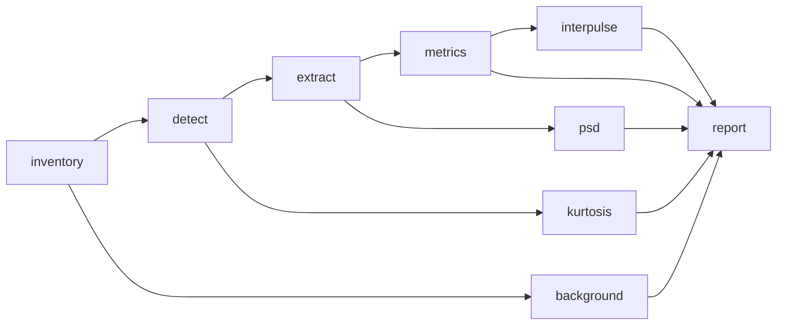

# RODEO II - Pile-Driving Soundscape Analysis

William Jenkins, Ph.D.  
Scripps Institution of Oceanography
University of California San Diego

Soundscape metrics for impulsive pile-driving noise recorded at offshore wind farm construction sites.
The analysis was developed for South Fork Wind (2023) and is generalized so the same workflow runs on any site, currently South Fork Wind and Vineyard Wind.

## Installation

```bash
uv sync --group dev
```

[TritonOA](https://github.com/TritonOA/TritonOA) is used to read raw recordings and is installed from GitHub.
The analyses in `scripts/` outside the workflow need the `full` extra (`uv sync --extra full`), which also installs [rodeo](https://github.com/NeptuneProjects/RODEO-II) from the main branch on GitHub, at the commit recorded in `uv.lock`.
To pick up newer rodeo commits, run `uv lock --upgrade-package rodeo`.
To work on rodeo alongside this project, run `uv pip install -e ../core` after `uv sync`; the next `uv sync` restores the locked commit.

To release a version, change `version` in `pyproject.toml` and push to `main`; a GitHub Actions workflow (`.github/workflows/tag-release.yml`) tags the commit `v<version>`.

## Workflow



| Stage       | What it does                                                                 |
| ----------- | ---------------------------------------------------------------------------- |
| `inventory` | Index the raw files of each sensor (or adopt an inventory built elsewhere).  |
| `detect`    | Detect pile strikes automatically on each sensor's detection channel.        |
| `extract`   | Window every channel around each strike, calibrated to uPa.                  |
| `metrics`   | Per-pulse metrics for each channel; writes a site-wide summary table.        |
| `psd`       | Power spectral density and decidecade band exposure of each pulse.          |
| `background` | Background noise (ISO 18406) in a window preceding each event: levels, band levels, and spectral densities over pulse-length segments; kurtosis per minute. |
| `kurtosis`  | Kurtosis of the recording in 60 s windows over each event (Martin et al. 2020). |
| `interpulse` | Sound between strikes in 100 ms segments, and the same over the background noise window (Guan et al. 2015); writes site-wide summaries. |
| `report`    | Figures, LaTeX tables, and a Word document (see [Figures and tables](#figures-and-tables)). |
| `supplement` | PDF data supplement tabulating every pulse (see [Data supplement](#data-supplement)). |

Run from the repository root:

```bash
soundscape run --site config/sites/southfork.toml --data-dir /path/to/raw/data   # everything
soundscape detect --site config/sites/vineyard.toml                                 # one stage
soundscape extract --site config/sites/southfork.toml --event A08 --sensor VLA1
```

`--event` and `--sensor` are repeatable. Naming an event explicitly runs it even if the site configuration excludes it.

Three shell scripts in `scripts/` wrap the usual runs, and work from any directory:

```bash
scripts/run_site.sh southfork           # detect --reselect, then metrics through supplement
scripts/run_site.sh vineyard report     # only the named steps
scripts/compare.sh                      # cross-site outputs in results/compare
scripts/publish.sh [reference.docx]     # reports/hdr_report/*.md to Word with pandoc
```

## Site configuration

Each site is one TOML file in `config/sites/`, with its tables alongside:

```
config/sites/
├── southfork.toml
├── southfork/
│   ├── events.csv    # event, pile, start, end  (UTC)
│   └── piles.csv     # pile, latitude, longitude
├── vineyard.toml
└── vineyard/
    ├── events.csv
    ├── piles.csv
    └── calibration/3dvha_cal.csv
```

The TOML sets the output directory, the processing parameters, the sensors, and any excluded events or event–sensor pairs.
Each sensor has a description, a position and water depth, its channels, the channel used for detection, a data source, a calibration, and a description of each hydrophone:

```toml
[[sensors]]
name = "VLA1"
description = "SHRU 905 recorder on vertical line array 1"
latitude = 41.08506
longitude = -71.07804
water_depth_m = 34.5
channels = [0, 1, 2, 3]
detect_channel = 0
# [sensors.source] and [sensors.calibration] ...

[[sensors.hydrophones]]
channel = 0
depth_m = 16.2
serial_number = "722013"
description = "CH-0 hydrophone"
```

Hydrophone entries are descriptive (calibration stays in `[sensors.calibration]`), and channels that are not analyzed may be listed to document the instrument.
The serial number identifies a hydrophone across deployments; sensor names such as `VLA1` are labels for one site only, and a serial number may appear only once per site.
`depth_m` is the hydrophone's depth below the sea surface, which moorings are adjusted to keep consistent between deployments; `water_depth_m` is the water depth at the sensor, which changes with the site.
Hydrophone depth and serial number are carried into `metrics.csv`, `background_spl.csv`, the pulse files, and the event tables, so results can be compared by depth.

### Data sources

The site files do not say where the raw data are stored.
Data source directories are relative to a data directory passed at run time with `--data-dir`, which the `inventory` stage (and `run`) needs:

```bash
soundscape inventory --site config/sites/southfork.toml --data-dir /path/to/southfork/raw/data
```

All later stages read data through the TritonOA inventory this builds, which records each file's full path, so they need no `--data-dir`.
Rerun `inventory` after moving the data or switching machines.
A source directory given as an absolute path is used as is.
A file whose headers cannot be read (e.g. a corrupt recording) is left out of the inventory with a warning naming it, and the stage carries on; the run's log lists every file left out.

- `type = "glob"` builds the inventory by reading the headers of files in `directory` that match `pattern` (on local disk or a mounted share), with an optional clock-drift correction.
- `type = "inventory"` adopts an inventory built elsewhere. `path_map` rewrites file path prefixes so the same inventory works on another machine.

This replaces the earlier `paths.toml`/`.env` machine-alias scheme.

New kinds of source (e.g. fetching over SSH) can be added in `src/soundscape/sources.py` by implementing `DataSource.prepare()`.

### Calibration

Inventories are kept unconditioned; calibration is applied by this package from the site file:

- `flat`: frequency-independent sensitivity and fixed gain per channel, converting 24-bit counts to uPa (SHRU).
- `frequency_response`: deconvolves a tabulated sensitivity curve from a voltage time series (e.g. a WHOI 3D VHA).
- `none`: data are already in uPa.

Sensitivities are in dB re 1 V/uPa and must be negative.

## Strike detection

Strikes are detected by band-limited mean-square sound pressure, generalizing the Vineyard Wind approach:

1. **Scan.** The detection channel is band-passed (`band`, default 100–300 Hz), squared, and averaged over a moving window of `smooth_s`, giving the band-limited mean-square sound pressure e(t). Local maxima at least `min_interval_s` apart are saved as candidates (`e`), with the median of e over each chunk, the background noise level in the band (`e_bg`). This is the only step that reads data.
2. **Select.** A candidate is a strike when `e_rel`, its e relative to the largest candidate e within `normalization_window_s`, is at least `threshold`, and when `SNR_det` = 10 log10(e / `e_bg`) is at least `min_snr_db`. Setting `normalization_window_s = 0` normalizes by the event maximum (the Vineyard Wind behavior), which misses soft-start strikes in long events.
3. **Regularity.** Pile strikes come in trains about 1–2 s apart, so a strike also needs at least `min_neighbors` other strikes within ±`neighbor_window_s` (default 2 within ±4 s). This rejects isolated transients such as mooring noise, which is broadband and cannot be removed by the choice of band. It can also reject a genuinely isolated strike, e.g. a single blow between piling sequences. Set `min_neighbors = 0` to disable.

All channels of a sensor are windowed at the same strike times, so detections are synchronized across channels.

On Vineyard Wind (pile AN36, 1 December 2023), these settings find all 2,928 strikes of the original hand-tuned analysis on each of the three sensors tested (3DVHA, VLA1, VLA2), within 0.5 s, plus the soft-start strikes that preceded its first time range, without hand-picked time ranges. Raising the band to 300–500 Hz lost 16–23% of the strikes at these 13 km ranges.

To tune the detector, inspect `results/<site>/events/<event>/detections_<sensor>.png`, edit `[detector]` (or a sensor's `[sensors.detector]` override), and re-apply the thresholds to the saved candidates without re-reading data:

```bash
soundscape detect --site config/sites/southfork.toml --reselect
```

## Outputs

```
results/<site>/
├── inventory/<sensor>.csv
├── events/<event>/
│   ├── candidates_<sensor>.parquet
│   ├── detections_<sensor>.csv     # strike times, e, e_bg, SNR_det, e_rel
│   ├── detections_<sensor>.png     # detector diagnostic
│   ├── pulses_<sensor>.h5          # (strike, channel, sample) waveforms in uPa
│   ├── metrics_<sensor>.csv
│   ├── psd_<sensor>.h5
│   ├── interpulse_segments_<sensor>.parquet   # 100 ms levels between strikes
│   ├── interpulse_intervals_<sensor>.parquet  # medians per interval, per band
│   └── interpulse_background_<sensor>.parquet    # 100 ms levels before the event
├── metrics.csv                     # all events, sensors, channels
├── background.h5                      # background noise segment levels, band levels, spectral densities per event/sensor
├── background_spl.csv                 # background noise Lp and beta per 1 min interval
├── kurtosis.csv                    # beta per 60 s window of each event
├── interpulse_{excess,bands,hist}.csv  # inter-pulse summaries
├── logs/<command>_<time>.log       # one log per run, as printed to the terminal
└── report/                         # figures and LaTeX tables
```

## Data dictionary

Column names follow one rule: a quantity that has a symbol in the reports is named by transliterating it (L<sub>p,pk</sub> → `Lp_pk`, L<sub>E,p,ss</sub> → `LEp_ss`, τ<sub>90%</sub> → `tau90`, β → `beta`) and is in the units the reports give for it; any other quantity carries its unit as a suffix (`range_m`, `depth_m`, `t_s`, `nominal_Hz`). Levels are in dB re 1 uPa (L<sub>p</sub>), dB re 1 uPa² s (L<sub>E,p</sub>), or dB re 1 uPa²/Hz (L<sub>p,f</sub>); times are in s and UTC. "PSD" in stage and file names (`psd`, `psd_<sensor>.h5`, `psd.png`) is the generic term for the mean-square sound pressure spectral density of ISO 18405 (§3.1.3.13, Note 6).

Every table identifies its rows by `event`, `sensor`, `channel`, and where relevant `pile`, `range_m` (horizontal range from the pile to the sensor), `depth_m` and `serial_number` (of the hydrophone), and `valid` (usable: no recording gap, and for pulses no click).

| Table | Row | Columns |
| ----- | --- | ------- |
| `events/<e>/candidates_<s>.parquet` | candidate peak on the detection channel | `time`; `e`, the band-limited mean-square sound pressure e (uPa²); `e_bg`, the median of e over the 5 min section of the event (`[detector] chunk_s`; the last may be shorter) containing the peak (uPa²) |
| `events/<e>/detections_<s>.csv` | detected strike | `strike` (number, in time order), `time`, `e`, `e_bg`; `SNR_det` = 10 log10(e / e_bg) (dB); `e_rel`, e relative to the largest e within the normalization window |
| `metrics.csv`, `events/<e>/metrics_<s>.csv` | pulse and hydrophone | `strike`, `time`, `valid`, `clicks`, `t5`, `t95`, `TW`, `Lp_pk`, `Lp_pkpk`, `Lp_90`, `LEp_ss`, `LEp_cum`, `tau90`, `t_r`, `t_d` (see *Metrics*) |
| `background_spl.csv` | 1 min interval of the background noise window | `interval_start`; `Lp`, mean-square sound pressure level; `beta`, kurtosis β |
| `kurtosis.csv` | 60 s window of an event | `window_start`, `n_strikes` (detected strikes in it), `beta` |
| `report/tables/<e>_bands.csv` | hydrophone and decidecade band | `nominal_Hz` (ISO 266 label), `f_n` (exact center frequency, Hz); median, 5th and 95th percentiles (`_median`, `_p5`, `_p95`) of `LEp_ss` (pulse band L<sub>E,p,ss,n</sub>), `Lp_bg` (background noise band L<sub>p,n</sub>), and `LEp_bg` (background noise band L<sub>E,p,bg,n</sub> over T<sub>W</sub>) |
| `events/<e>/interpulse_segments_<s>.parquet` | 100 ms segment after a strike | `t_s` (time since the strike), `spacing_s` (to the next strike), `Lp` (broadband), `Lp_band` (summary band), `in_interval` (from t<sub>95</sub> to the next t<sub>5</sub>) |
| `events/<e>/interpulse_intervals_<s>.parquet` | inter-pulse interval | `start_s` (its start, t<sub>95</sub> of the strike, from the detection time), `duration_s`, `n_segments`; medians over its segments of `Lp`, `Lp_band`, and each decidecade band `Lp_<f>Hz` |
| `events/<e>/interpulse_background_<s>.parquet` | 100 ms segment of the background noise window | `start` (segment start time), `Lp`, `Lp_band`, `Lp_<f>Hz` |
| `interpulse_excess.csv` | hydrophone | `Lp_median`, `Lp_p5`, `Lp_p95` (inter-pulse L<sub>p,ip</sub>), `Lp_bg` (background noise median), `dL` (ΔL<sub>ip</sub>, dB), `above_<t>` (fraction of inter-pulse time more than t dB above `Lp_bg`), `interval_share` (fraction of the strike spacing in the interval) |
| `interpulse_bands.csv` | hydrophone and decidecade band | `nominal_Hz`, `dL` |
| `interpulse_hist.csv` | hydrophone, `kind` (`interpulse` or `background`), and level bin | `Lp_band` (bin's lower edge), `count` |
| `compare/tables/summary.csv` | event, sensor, detection channel | `range_km`, `pulses`, medians of `range_metrics`, `LEp_cum_event` (L<sub>E,p,cum</sub> over the event) |
| `compare/tables/range_fits.csv` | site and `metric` | least-squares fit of the per-event medians to a − b log10(R / 1 km): `a_dB` (level at 1 km), `b_dB_per_decade` |
| `compare/tables/background_fits.csv` | site and sensor (`all` for every sensor) | the same fit of the background noise level: `n`, `range_min_km`, `range_max_km`, `a_dB`, `b_dB_per_decade`, `r` (correlation of the level with log10 R) |
| `compare/tables/masking.csv` | site and sensor | `dL_median`, `dL_min`, `dL_max` (over events); `range_left`, `area_left` (fractions of detection range and communication space left for cylindrical spreading, `[interpulse] spreading` log10 r) |
| `compare/tables/masking_bands.csv` | site, sensor, and decidecade band `nominal_Hz` | `range_min_km`, `range_max_km`, `events`; `dL_median`, `dL_min`, `dL_max` (the band's inter-pulse excess over events); `range_left`, `area_left` as in `masking.csv` |

## Figures and tables

`soundscape report` writes, for each event:

- `figures/<event>/metrics.png`: metric time series, one column per sensor (nearest first), colored by hydrophone, with kurtosis in 60 s windows in the bottom row.
- `figures/<event>/psd.png`: mean-square sound pressure spectral density level L<sub>p,f</sub> of the pulses and of the background noise (over 1.2 s segments before the event), each as the median and 5th to 95th percentiles in dB, per sensor and hydrophone.
- `figures/<event>/bands.png`: decidecade band levels per sensor and hydrophone: L<sub>E,p,ss</sub> in each band, against the sound exposure level of the background noise over a segment of the same length, each as the median and 5th to 95th percentiles. The gap between them is the signal-to-noise ratio in each band.
- `figures/<event>/levels.png`: distribution of `histogram_metric` per hydrophone and sensor.
- `tables/<event>.tex`: per-pulse metrics, one row per hydrophone (sensor, range, serial number, depth), each as the median with the 5th and 95th percentiles in brackets. Times are in ms.
- `tables/<event>_event.tex`: event-level quantities per hydrophone: serial number, valid pulses, L<sub>E,p,cum</sub> over them, the percentage of them with SNR below 10 dB, kurtosis over the 60 s windows that contain strikes, and background noise kurtosis (median [5th, 95th percentile]), with the mean wind speed and significant wave height if configured.
- `tables/<event>_bands.csv`: the band statistics behind `bands.png`, per sensor, hydrophone, and band, with the background noise mean-square sound pressure level in each band (see *Data dictionary*).

and for the whole site:

- `figures/coverage.png`: when each sensor was recording, with every event in the site file on the same time axis, its window, and the sensors that recorded it. It is drawn from the inventories, so it needs no metrics.
- `figures/<metric>_vs_range.png`: each of `range_metrics` against range on each sensor's detection channel, colored by strike number, with the median and interquartile range per event and sensor.
- `tables/detections.tex`: strikes and median SNR<sub>det</sub> per event and sensor.
- `figures/interpulse_cdf.png`: cumulative distributions of the 100 ms levels between strikes and in the background noise windows, per sensor.

After `interpulse`, the event tables also give the inter-pulse level L<sub>p,ip</sub>, its median excess over the background noise ΔL<sub>ip</sub>, and the percentage of inter-pulse time more than each of `[interpulse] thresholds_db` above the background noise.

It also writes `report.docx`, which collects the figures and tables with captions written from the data, for pasting into a shared Word report.
Tables are native Word tables, with each event's tables on a landscape page, and captions are numbered with Word fields, so they renumber in the document they are pasted into (select all and press F9).

### Data supplement

```bash
soundscape supplement --site config/sites/southfork.toml
```

writes `report/supplement.pdf`, a stand-alone PDF tabulating every valid pulse on every hydrophone. It's separate from `report.docx`.
The PDF contains:

- a title page (with `[report] author` and `affiliation`) and a contents table linking to each event;
- a page defining the columns;
- one table per event, in chronological order. Rows are ordered by sensor (nearest first), hydrophone (shallowest first), and strike, and each row gives the hydrophone's serial number and depth.

Column headers repeat on every page, the page header names the event, and PDF bookmarks lead to each event and sensor.

The LaTeX source is written to `report/supplement/supplement.tex` and compiled there with `latexmk` (or `pdflatex` twice). Without LaTeX, only the `.tex` is written.
It needs the `geometry`, `lmodern`, `longtable`, `booktabs`, `makecell`, `array`, `fancyhdr`, `lastpage`, and `hyperref` packages. On Debian/Ubuntu these are in `texlive-latex-recommended`, `texlive-latex-extra`, `texlive-fonts-recommended`, and `lmodern`, plus `latexmk`.
A site of about 400,000 pulse records gives a PDF of several thousand pages and takes a while to compile; `run` includes this stage.

### Comparing sites

```bash
soundscape compare --site config/sites/southfork.toml --site config/sites/vineyard.toml --output results/compare
```

reads each site's results (valid pulses from events it does not exclude) and writes:

- `figures/levels_vs_range.png`: median and interquartile range of each of `range_metrics` per event and sensor against range (log scale), with a least-squares fit of a − b log10 R for each site, and the event total L<sub>E,p,cum</sub>.
- `figures/depth.png`: median level on each hydrophone relative to the mean over its sensor, against hydrophone depth, for sensors with hydrophones at more than one depth.
- `figures/psd.png`: median L<sub>p,f</sub> of the pulses for each event and sensor, colored by range, one panel per site, with that of the background noise.
- `tables/summary.{csv,tex}`: per site, event, and sensor, the range, hydrophone depth, pulses, median of each of `range_metrics`, and event total L<sub>E,p,cum</sub> (`LEp_cum_event`).
- `tables/range_fits.csv`: the fit coefficients.
- `figures/background_vs_range.png`, `tables/background_fits.csv`: pre-piling background noise level (median 100 ms Lp in the inter-pulse summary band, from `interpulse`) against range, with fits of a − b log10 R per site and per sensor and the correlation r; at South Fork it falls about 23 dB per decade, showing that the construction vessels and equipment at the pile dominate the pre-piling background noise.
- `figures/interpulse_vs_range.png`: inter-pulse excess over the background noise, and the percentage of inter-pulse time above each threshold, against range.
- `figures/interpulse_bands.png`: inter-pulse excess over the background noise per decidecade band and sensor.
- `tables/masking.csv`: median inter-pulse excess per site and sensor, and the detection range and communication space remaining for cylindrical spreading (`[interpulse] spreading`, default 10).
- `tables/masking_bands.csv`, `figures/masking_bands.png`: the same for the median excess in each decidecade band; the figure shows the detection range remaining against band frequency.
- `compare.docx`: the above with captions.

Except for the depth figure, levels are on each sensor's detection channel.
Figure style, metrics, and Word template come from the first site's `[report]`.

### Configuration

Hydrophones are labeled by sensor, serial number, and depth, e.g. `VLA1 Serial 722013 (16.2 m)`, so results can be matched to hydrophone sensitivities, which are listed by serial number. Sensor names are labels for one deployment only. The same serial can appear on different moorings at different sites.

Figures and tables use valid pulses only. Configure them in `[report]`:

```toml
[report]
style = "config/jasa_fig_style.mplstyle"  # optional matplotlib style
met = "data/met/met_2023.csv"             # optional: datetime, WSPD, WVHT columns (scripts/data/met_data.py)
metrics = ["Lp_pk", "Lp_pkpk", "Lp_90", "LEp_ss", "LEp_cum", "tau90", "t_r", "t_d", "SNR"]
histogram_metric = "Lp_pk"
range_metrics = ["Lp_pk", "Lp_pkpk", "LEp_ss"]
dpi = 300
titles = true                             # false leaves titles off figures, for captioned documents
docx_template = "shared_report.docx"      # optional: styles for report.docx, e.g. the shared report downloaded as .docx
```

The stations behind `met` are recorded under `[report]`, with their positions, so captions can give their distance from the sensors:

```toml
[[report.met_stations]]
name = "44097"
description = "Block Island, RI (CDIP 154) Waverider buoy"
latitude = 40.966
longitude = -71.123
variables = ["WVHT"]
source = "https://www.ndbc.noaa.gov/station_page.php?station=44097"
```

`met` is built from NDBC standard meteorological files with `scripts/data/met_data.py --wind <file> --wave <file> --output <csv>`, which treats NDBC's missing-value codes (99, 999, 9999) as missing.
Both sites use BUZM3 wind and 44097 waves for 2023 (`data/met/met_2023.csv`).

The tables need `\usepackage{booktabs, longtable, makecell}`.

## Metrics

Per-pulse metrics follow ISO 18406:2017 (*Measurement of radiated underwater sound from percussive pile driving*), with quantities, levels, and symbols as defined in ISO 18405:2017, p₀ = 1 uPa and E<sub>p,0</sub> = 1 uPa² s.
Column names transliterate the symbols (see *Data dictionary*).

| Column | Symbol | Definition |
| ------ | ------ | ---------- |
| `Lp_pk` | L<sub>p,pk</sub> | peak sound pressure level, 20 log10 (p<sub>pk</sub> / p₀) (dB re 1 uPa) |
| `Lp_pkpk` | L<sub>p,pk-pk</sub> | peak-to-peak sound pressure level, 20 log10 (p<sub>pk-pk</sub> / p₀) (dB re 1 uPa) |
| `Lp_90` | L<sub>p,90</sub> | mean-square sound pressure level over τ<sub>90%</sub> (dB re 1 uPa) |
| `LEp_ss` | L<sub>E,p,ss</sub> | single-strike sound exposure level (SEL<sub>ss</sub> in ISO 18406), 10 log10 (∫p² dt / E<sub>p,0</sub>) over the integration time T<sub>W</sub>, i.e. 100% of the pulse energy (dB re 1 uPa² s) |
| `LEp_cum` | L<sub>E,p,cum</sub> | cumulative sound exposure level (SEL<sub>cum</sub> in ISO 18406), running over valid strikes in time order (dB re 1 uPa² s) |
| `tau90` | τ<sub>90%</sub> | pulse duration: the 90% energy signal duration, from 5% to 95% of the pulse's sound exposure (s; reported in ms) |
| `t_r`, `t_d` | t<sub>r</sub>, t<sub>d</sub> | rise time, from the start of τ<sub>90%</sub> to the peak within it, and decay time, from that peak to its end (s; reported in ms) |
| `t5`, `t95` | t<sub>5</sub>, t<sub>95</sub> | start and end of τ<sub>90%</sub> relative to the detection time (s) |
| `TW` | T<sub>W</sub> | the pulse's integration time (s): the window, or less where strikes are closer together (see below) |
| `clicks` | | number of clicks from the recording chain in the window (see below) |
| `SNR` | SNR | added at report time: `LEp_ss` less the sound exposure level of the background noise over `TW` (dB; see below) |

The window (`[extract] pre_s + post_s`, 1.2 s) is long enough to hold the whole pulse, so `LEp_ss` includes the background noise in it and is biased upward at low signal-to-noise ratio.
Where strikes are less than a window apart (10% of pulses at Vineyard Wind 1, 0.2% at South Fork Wind), each pulse is integrated only up to halfway to the neighboring detection times, so that the integration time is the period between strikes (ISO 18406 §6.4.2.1.2) and no sound counts twice in `LEp_cum` (`extract.integration_bounds`). Every metric, the spectral densities, and the band exposures use this integration time; clicks are sought in the whole window.

The peak for `t_r` and `t_d` is taken within τ<sub>90%</sub>, so both are non-negative; `Lp_pk` is the peak over the whole integration time.

The signal-to-noise ratio (ISO 18406 §3.17, §8.4.1) is computed at report time (`report.load_metrics`, so the report, supplement, and compare all have it) as `LEp_ss` − (L<sub>p,bg</sub> + 10 log10 `TW`), where L<sub>p,bg</sub> is the median mean-square sound pressure level of the background noise segments on that hydrophone. ISO 18406 §4.2.4 requires at least 10 dB; pulses below it are flagged in the event tables, not dropped. It is distinct from the detector's `SNR_det`.

`valid` is per pulse and hydrophone. A pulse is invalid where its window touches a data gap (all hydrophones of the sensor) or where the hydrophone's window holds a click: a sample departing from the mean of its neighbors by more than `[extract] click_threshold` (default 30) times the window's median departure, and by at least half the largest |p| within two samples (so loud band-limited sound, which changes little between samples relative to its amplitude, is not mistaken for a click).
Such pulses are dropped rather than repaired, and are left out of `LEp_cum`, the spectral density and band statistics (`channel_valid` in `psd_<sensor>.h5`), the figures, and the supplement.
The clicks come from the recording chain on VLA2 Serial 722015 at Vineyard Wind 1 (AN36, AP35, and fewer in AR34 and AT33). On every other hydrophone at most one pulse per event exceeds the threshold.

Kurtosis β (ISO 18405 sound pressure kurtosis; 3 for Gaussian noise) is computed by the `kurtosis` stage over consecutive 60 s windows of the continuous recording on every channel, following Martin et al. (2020), not per pulse.
`kurtosis.csv` gives β (`beta`) for each window, with its start, whether it is free of gaps, and the number of detected strikes in it; the event tables summarize the windows that contain strikes.
The `background` stage gives the same statistic over its 1 min intervals (`[background] interval_s`) before each event.
Configure it in `[kurtosis]` (`window_s`, `chunk_windows`, `filter`).

### Band levels

Pulses and background noise are compared in decidecade bands: base-10 one-third octaves (IEC 61260-1), with exact centers 10^(n/10) Hz, labeled by their nominal centers (12.5, 16, 20, … Hz).
The `psd` stage computes each pulse's sound exposure in every band from the DFT of the whole window (`band_exposure` in `psd_<sensor>.h5`). By Parseval's theorem the bands sum to the sound exposure behind `LEp_ss`.
Background noise band levels are computed by the `background` stage in the same way, from the DFT of each segment of the pulse window's length (`segment_band_ms` in `background.h5`).
They are shown as the exposure the background noise gives over that segment, so both curves are in dB re 1 uPa² s.
Bands lie between `[bands] fmin` (default 10 Hz, the high-pass corner) and `fmax`, which defaults to `nyquist_fraction` (0.8) of the Nyquist frequency so the top band stays clear of the recorders' anti-aliasing roll-off. At the 19.5 kHz sampling rate of both sites the top band is 6.3 kHz (upper edge 7.1 kHz); the 8 kHz band (7.9–8.9 kHz) is left out.

### Background noise

Reports use the terms of ISO 18405 and 18406 strictly. *Background noise* (ISO 18406 §3.4; ISO 18405 §3.6.1.5) is all sound recorded without the pile-driving signal: ambient noise (ISO 18405 §3.1.5.11) plus the receiver's self-noise (e.g. flow noise, cable strum). That is what is measured, so the reports, the code (the `background` stage, `[background]` config, `background.h5`, `background_spl.csv`, `interpulse_background_*`, `Lp_bg`, `bg_median`), and the outputs all say "background noise"; "ambient" is used only in its ISO 18405 sense. `tests/test_wording.py` checks the generated reports.

Background noise is measured as §6.1.4 specifies: at the same hydrophones, with the same 10 Hz high-pass filter as the pulses, when no piling sound is present (the `[background]` window, by default the 10 min ending 1 min before each event).
Levels are averaged over the same time as the signal they are compared with (§6.1.4 Note 1, §3.17 Note 2): the window is cut into consecutive segments of `[background] segment_s`, by default the pulse window (1.2 s), and each segment's mean-square sound pressure level (`segment_Lp`), decidecade band mean-square sound pressures (`segment_band_ms`), and mean-square sound pressure spectral density (Welch's method with the `[pulse_psd]` settings; stored as percentiles of L<sub>p,f</sub>, `segment_psd_{median,p5,p95}`) are written to `background.h5`.
Segments overlapping a gap or holding a click (as for pulses) are invalid (`segment_valid`). The background noise level of an event and hydrophone is the median over valid segments (`report.background_levels`).

Background noise is not reported as one broadband level in the tables: half its power lies below about 25–35 Hz, where flow noise and cable strum contaminate moored measurements (ISO 18406, §4.2.2). It enters the broadband SNR, where ISO 18406 §4.2.4 Note 1 counts deployment noise as noise. `background_spl.csv` keeps the broadband `Lp` and `beta` per 1 min interval.

### Inter-pulse sound field

The `interpulse` stage (Optional Task 2.4.4) follows Guan et al. (2015, JASA 138:3447; 2017, POMA 27:070023).
It reads the raw data from each strike's detection time to the next and computes the mean-square sound pressure level in consecutive 100 ms segments (`[interpulse] segment_s`), broadband, in the summary band (`band`, default 20 Hz to the top decidecade band, which covers low-frequency cetaceans within the recorded bandwidth), and in each decidecade band, from the DFT of each segment.
Segments are tagged as inside the inter-pulse interval, from t95 of one pulse to t5 of the next on that hydrophone (`t95` and `t5` in the metrics tables, relative to the detection time).
Event-sensor pairs with fewer than `min_strikes` (100) detected strikes, such as an abandoned soft start, are left out of the analysis from `metrics.csv` on.
Intervals with an invalid pulse at either end, in a recording gap, or longer than `max_spacing_factor` (2) times the median strike spacing (a pause) are left out.
Each interval is summarized by the median of its segments, because the 5% of each pulse's energy outside τ<sub>90%</sub> would dominate a mean square.
The same segments over the background noise window before each event give the reference; the excess ΔL_ip is the median inter-pulse level less the background noise median.
With cylindrical spreading, transmission loss 10 log₁₀ r (`[interpulse] spreading`), the excess scales the detection range by 10^(−ΔL/10) and the communication space of Clark et al. (2009), the area within which a call can be detected, by 10^(−ΔL/5).
It takes about 2 min per event and sensor (3,000 strikes) and 2.2 GB of memory; rerun `metrics` first if its tables predate `t5`.

### Differences from the 2025 South Fork analysis

Checked on 1,200 A10-B Tetra pulses from the earlier analysis:

- `Lp_pk`, `Lp_pkpk`, `t_r`, and `t_d` reproduce the earlier values.
- The earlier `SEL` was the mean-square sound pressure level over τ<sub>90%</sub> (now `Lp_90`), not a sound exposure level. The single-strike `LEp_ss` is 2.1 dB lower on average (−3.2 to +0.2 dB), and `LEp_cum` changes accordingly.
- The earlier `kurtosis` was excess kurtosis (β₂ − 3) of each pulse; it is now β over 60 s windows.
- The mean-square sound pressure level over the whole window, which depended on the window length, is no longer computed.
- Strike detection was an STA/LTA detector tuned by hand per event and channel. It is now automatic.

## Adding a site

1. Write `config/sites/<site>/events.csv` and `piles.csv`.
2. Copy an existing site TOML, then set the sensors, their data sources, and their calibration.
3. Run `soundscape inventory --data-dir <path>`, then `soundscape detect`, and check the diagnostic figures before running the remaining stages.

## Tests

```bash
uv run pytest
```

The tests use synthetic recordings and need no data.

## Legacy scripts

Apart from the three shell scripts above, `scripts/` holds the propagation, coherence, plotting, and reporting code from the 2025 South Fork analysis.
These scripts take their input and output paths as command-line arguments, read the earlier output formats, and need the `full` extra (`uv sync --extra full`).
The legacy soundscape pipeline (inventory, manual pulse extraction, metrics, background noise, pulse spectra) has been replaced by the `soundscape` package.
The 2025 event, detector, and equipment tables that some of these scripts read (`config/legacy/`) have been removed; their contents now live in `config/sites/southfork.toml` and `config/sites/southfork/piles.csv`.
