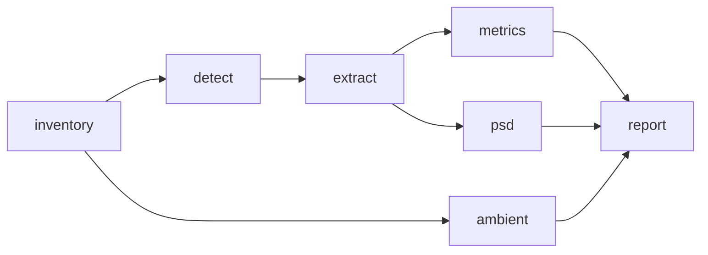

# RODEO II - Pile-Driving Soundscape Analysis

William Jenkins, Ph.D.  
Scripps Institution of Oceanography
University of California San Diego

Soundscape metrics for impulsive pile-driving noise recorded at offshore wind farm construction sites.
The analysis was developed for South Fork Wind (2023) and is generalized so the same workflow runs on any site, currently South Fork Wind and Vineyard Wind.

## Installation

```bash
uv sync --group dev
```

[TritonOA](https://github.com/TritonOA/TritonOA) is used to read raw recordings and is installed from GitHub over SSH.

## Workflow



| Stage       | What it does                                                                 |
| ----------- | ---------------------------------------------------------------------------- |
| `inventory` | Index the raw files of each sensor (or adopt an inventory built elsewhere).  |
| `detect`    | Detect pile strikes automatically on each sensor's detection channel.        |
| `extract`   | Window every channel around each strike, calibrated to uPa.                  |
| `metrics`   | Per-pulse metrics for each channel; writes a site-wide summary table.        |
| `psd`       | Power spectral density of each pulse.                                        |
| `ambient`   | SPL and PSD of ambient noise in a window preceding each event.               |
| `report`    | Figures, LaTeX tables, and a Word document (see [Figures and tables](#figures-and-tables)). |

Run from the repository root:

```bash
soundscape run --site config/sites/southfork.toml --data-dir /path/to/raw/data   # everything
soundscape detect --site config/sites/vineyard.toml                                 # one stage
soundscape extract --site config/sites/southfork.toml --event A08 --sensor VLA1
```

`--event` and `--sensor` are repeatable. Naming an event explicitly runs it even if the site configuration excludes it.

## Site configuration

Each site is one TOML file in `config/sites/`, with its tables alongside:

```
config/sites/
├── southfork.toml
├── southfork/
│   ├── events.csv    # event, pile, start, end  (UTC)
│   └── piles.csv     # pile, latitude, longitude
├── vineyard.toml
└── vineyard/
    ├── events.csv
    ├── piles.csv
    └── calibration/3dvha_cal.csv
```

The TOML sets the output directory, the processing parameters, the sensors, and any excluded events or event–sensor pairs.
Each sensor has a description, a position and water depth, its channels, the channel used for detection, a data source, a calibration, and a description of each hydrophone:

```toml
[[sensors]]
name = "VLA1"
description = "SHRU 905 recorder on vertical line array 1"
latitude = 41.08506
longitude = -71.07804
water_depth_m = 34.5
channels = [0, 1, 2, 3]
detect_channel = 0
# [sensors.source] and [sensors.calibration] ...

[[sensors.hydrophones]]
channel = 0
depth_m = 16.2
serial_number = "722013"
description = "CH-0 hydrophone"
```

Hydrophone entries are descriptive (calibration stays in `[sensors.calibration]`), and channels that are not analyzed may be listed to document the instrument.
The serial number identifies a hydrophone across deployments; sensor names such as `VLA1` are labels for one site only, and a serial number may appear only once per site.
`depth_m` is the hydrophone's depth below the sea surface, which moorings are adjusted to keep consistent between deployments; `water_depth_m` is the water depth at the sensor, which changes with the site.
Hydrophone depth and serial number are carried into `metrics.csv`, `ambient_spl.csv`, the pulse files, and the event tables, so results can be compared by depth.

### Data sources

The site files do not say where the raw data are stored.
Data source directories are relative to a data directory passed at run time with `--data-dir`, which the `inventory` stage (and `run`) needs:

```bash
soundscape inventory --site config/sites/southfork.toml --data-dir /path/to/southfork/raw/data
```

All later stages read data through the TritonOA inventory this builds, which records each file's full path, so they need no `--data-dir`.
Rerun `inventory` after moving the data or switching machines.
A source directory given as an absolute path is used as is.
A file whose headers cannot be read (e.g. a corrupt recording) is left out of the inventory with a warning naming it, and the stage carries on; the run's log lists every file left out.

- `type = "glob"` builds the inventory by reading the headers of files in `directory` that match `pattern` (on local disk or a mounted share), with an optional clock-drift correction.
- `type = "inventory"` adopts an inventory built elsewhere. `path_map` rewrites file path prefixes so the same inventory works on another machine.

This replaces the earlier `paths.toml`/`.env` machine-alias scheme.

New kinds of source (e.g. fetching over SSH) can be added in `src/soundscape/sources.py` by implementing `DataSource.prepare()`.

### Calibration

Inventories are kept unconditioned; calibration is applied by this package from the site file:

- `flat`: frequency-independent sensitivity and fixed gain per channel, converting 24-bit counts to uPa (SHRU).
- `frequency_response`: deconvolves a tabulated sensitivity curve from a voltage time series (e.g. a WHOI 3D VHA).
- `none`: data are already in uPa.

Sensitivities are in dB re 1 V/uPa and must be negative.

## Strike detection

Strikes are detected by band-limited energy, generalizing the Vineyard Wind approach:

1. **Scan.** The detection channel is band-passed (`band`, default 100–300 Hz), squared, and smoothed over `smooth_s`. Local maxima at least `min_interval_s` apart are saved as candidates, with the noise floor (median energy) of each chunk. This is the only step that reads data.
2. **Select.** A candidate is a strike when its energy is at least `threshold` times the largest candidate energy within `normalization_window_s`, and at least `min_snr_db` above the noise floor. Setting `normalization_window_s = 0` normalizes by the event maximum (the Vineyard Wind behavior), which misses soft-start strikes in long events.
3. **Regularity.** Pile strikes come in trains about 1–2 s apart, so a strike also needs at least `min_neighbors` other strikes within ±`neighbor_window_s` (default 2 within ±4 s). This rejects isolated transients such as mooring noise, which is broadband and cannot be removed by the choice of band. It can also reject a genuinely isolated strike, e.g. a single blow between piling sequences. Set `min_neighbors = 0` to disable.

All channels of a sensor are windowed at the same strike times, so detections are synchronized across channels.

On Vineyard Wind (pile AN36, 1 December 2023), these settings find all 2,928 strikes of the original hand-tuned analysis on each of the three sensors tested (3DVHA, VLA1, VLA2), within 0.5 s, plus the soft-start strikes that preceded its first time range, without hand-picked time ranges. Raising the band to 300–500 Hz lost 16–23% of the strikes at these 13 km ranges.

To tune the detector, inspect `results/<site>/events/<event>/detections_<sensor>.png`, edit `[detector]` (or a sensor's `[sensors.detector]` override), and re-apply the thresholds to the saved candidates without re-reading data:

```bash
soundscape detect --site config/sites/southfork.toml --reselect
```

## Outputs

```
results/<site>/
├── inventory/<sensor>.csv
├── events/<event>/
│   ├── candidates_<sensor>.parquet
│   ├── detections_<sensor>.csv     # strike times, energy, SNR
│   ├── detections_<sensor>.png     # detector diagnostic
│   ├── pulses_<sensor>.h5          # (strike, channel, sample) waveforms in uPa
│   ├── metrics_<sensor>.csv
│   └── psd_<sensor>.h5
├── metrics.csv                     # all events, sensors, channels
├── ambient.h5                      # ambient PSD per event/sensor
├── ambient_spl.csv                 # ambient SPL per interval
├── logs/<command>_<time>.log       # one log per run, as printed to the terminal
└── report/                         # figures and LaTeX tables
```

## Figures and tables

`soundscape report` writes, for each event:

- `figures/<event>/metrics.png`: metric time series, one column per sensor (nearest first), colored by channel.
- `figures/<event>/psd.png`: pulse PSD (mean ± 2σ, in dB) against the ambient PSD, per sensor and channel.
- `figures/<event>/levels.png`: distribution of `histogram_metric` per channel and sensor.
- `tables/<event>.tex`: mean, median, standard deviation, minimum, and maximum of each metric per sensor, one value per channel separated by slashes, with the ambient SPL and, if configured, the mean wind speed and significant wave height.

and for the whole site:

- `figures/coverage.png`: when each sensor was recording, with every event in the site file on the same time axis, its window, and the sensors that recorded it. It is drawn from the inventories, so it needs no metrics.
- `figures/<metric>_vs_range.png`: each of `range_metrics` against range on each sensor's detection channel, colored by strike number, with the median and interquartile range per event and sensor.
- `tables/detections.tex`: strikes and median SNR per event and sensor.
- `tables/pulses.tex`: every pulse and channel, as a `longtable` for an appendix.

It also writes `report.docx`, which collects the figures and tables (except `pulses.tex`) with captions written from the data, for pasting into a shared Word report.
Tables are native Word tables, with each event table on a landscape page, and captions are numbered with Word fields, so they renumber in the document they are pasted into (select all and press F9).
`metrics.csv` stands in for the pulse-by-pulse table as a data supplement.

Figures and tables use valid pulses only. Configure them in `[report]`:

```toml
[report]
style = "config/jasa_fig_style.mplstyle"  # optional matplotlib style
met = "data/met/data.csv"                 # optional: datetime, WSPD, WVHT columns
metrics = ["SPL_rms", "SPL_pk", "SPL_pkpk", "SEL", "SEL_cum", "t_rise", "t_decay", "kurtosis"]
histogram_metric = "SPL_pk"
range_metrics = ["SPL_pk", "SPL_pkpk", "SEL"]
dpi = 300
titles = true                             # false leaves titles off figures, for captioned documents
docx_template = "shared_report.docx"      # optional: styles for report.docx, e.g. the shared report downloaded as .docx
```

The tables need `\usepackage{booktabs, longtable, makecell}`.

## Metrics

Following ISO 18405, referenced to 1 uPa, for each pulse window p(t):

| Column      | Definition                                                         |
| ----------- | ------------------------------------------------------------------ |
| `SPL_pk`    | 20 log10 max\|p\| (dB re 1 uPa)                                    |
| `SPL_pkpk`  | 20 log10 (max p − min p) (dB re 1 uPa)                             |
| `SPL_rms`   | mean-square pressure over the whole window (dB re 1 uPa)           |
| `SPL_rms90` | mean-square pressure over T90, the 5–95% cumulative-energy interval |
| `SEL`       | 10 log10 (∫p² dt) over the window (dB re 1 uPa² s)                 |
| `SEL_cum`   | running energy sum of `SEL` over strikes in time order             |
| `T90`, `t_rise`, `t_decay` | duration of T90; start of T90 to peak; peak to end of T90 (s) |
| `kurtosis`  | Pearson kurtosis β₂ (3 for Gaussian noise)                          |

Windows include ambient noise, so `SPL_rms`, `SEL`, and the T90-based quantities are biased at low signal-to-noise ratio.

### Differences from the 2025 South Fork analysis

Checked on 1,200 A10-B Tetra pulses from the earlier analysis:

- `SPL_pk`, `SPL_pkpk`, `SPL_rms`, `t_rise`, and `t_decay` reproduce the earlier values.
- The earlier `SEL` was the mean-square level over T90 (now `SPL_rms90`), not an exposure. The new `SEL` is 2.1 dB lower on average (−3.2 to +0.2 dB), and `SEL_cum` changes accordingly.
- The earlier `kurtosis` was excess kurtosis (β₂ − 3); it is now β₂.
- Strike detection was an STA/LTA detector tuned by hand per event and channel. It is now automatic.

## Adding a site

1. Write `config/sites/<site>/events.csv` and `piles.csv`.
2. Copy an existing site TOML, then set the sensors, their data sources, and their calibration.
3. Run `soundscape inventory --data-dir <path>`, then `soundscape detect`, and check the diagnostic figures before running the remaining stages.

## Tests

```bash
uv run pytest
```

The tests use synthetic recordings and need no data.

## Legacy scripts

`config/legacy/events/` holds the 2025 South Fork event table, the hand-tuned STA/LTA detector settings for each event (`*.toml`, read only by `scripts/reports/table_detector.py`), and the piling intervals identified by hand in 2025 (`events_full.csv`).
`config/legacy/experiment/` holds the original South Fork equipment, hydrophone, and turbine tables; their contents now live in `config/sites/southfork.toml` and `config/sites/southfork/piles.csv`, and only `scripts/plotting/study_area.ipynb` still reads them.

`scripts/` holds the propagation, coherence, plotting, and reporting code from the 2025 South Fork analysis.
These scripts read paths from a `.env` file and the earlier output formats, and need the `legacy` extra (`uv sync --extra legacy`).
The legacy soundscape pipeline (inventory, manual pulse extraction, metrics, ambient noise, pulse PSD) has been replaced by the `soundscape` package.
